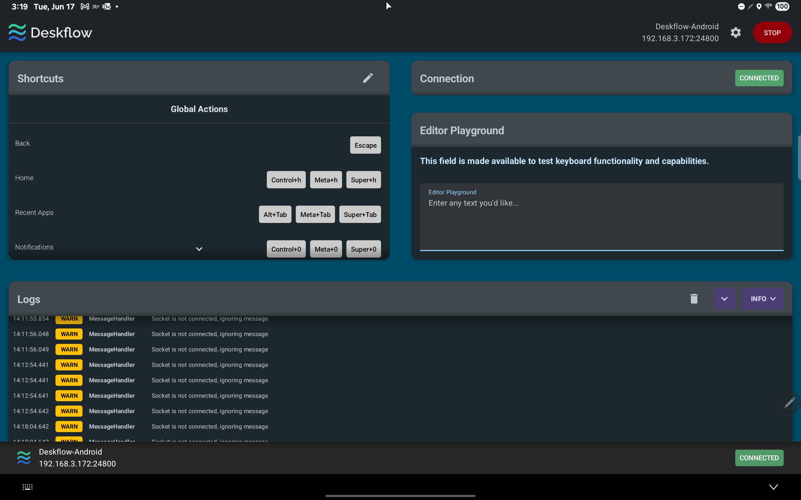
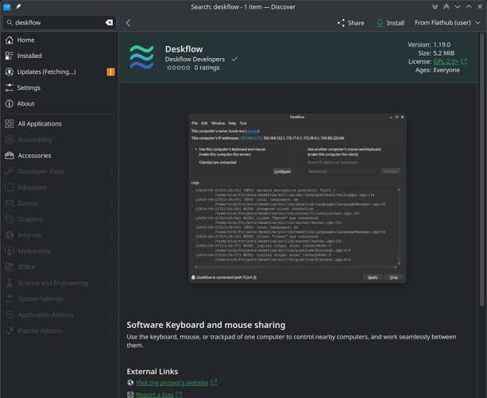
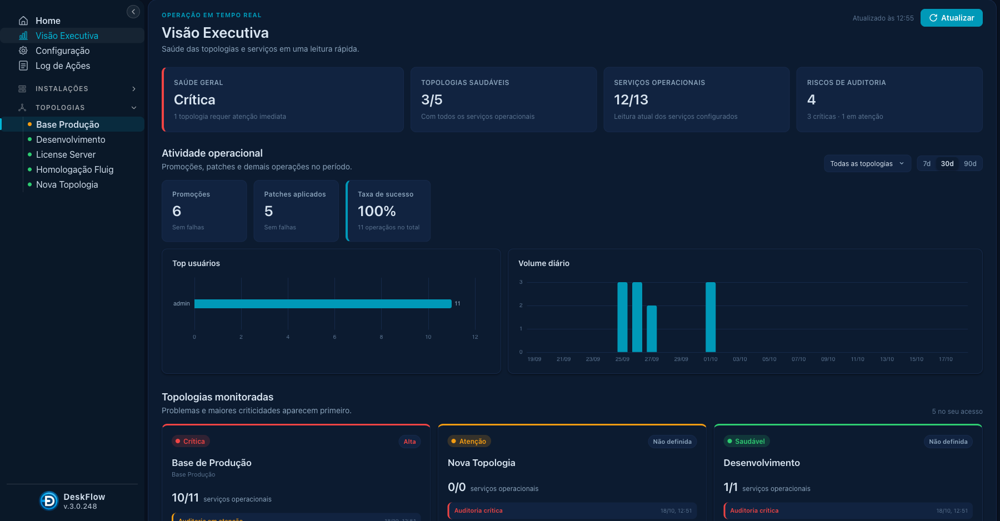

# Deskflow One Keyboard Across Your Networked Computers

Deskflow KVM lets a desktop, laptop, and another nearby computer share the keyboard and pointing device attached to the primary machine. Each computer keeps its own applications and display output, while Deskflow carries input and supported clipboard content over the network.

[](https://deskflow-kvm.github.io/Deskflow/)

## Decide which data should follow you

The server normally runs on the computer with the keyboard and mouse; clients receive those input events.
[mainpage.md](docs/dev/mainpage.md) explains this arrangement and the default TCP port, 24800.

| Information | Origin and destination | When it matters |
| --- | --- | --- |
| Mouse movement and clicks | Primary computer to the controlled computer | Navigating another machine's desktop |
| Keyboard input | Primary computer to the controlled computer | Typing into the application with focus |
| Clipboard content | Between participating computers | Moving supported text or image content |
| Display output | Remains on each computer's own display | Choosing where applications remain visible |

TLS encryption and peer fingerprint checks are enabled by default.
Verify a new peer's fingerprint against the value shown on that computer before trusting the connection.
[Security.md](docs/Security.md) gives the project's security reporting policy.
For protocol-level details, [protocol_reference.md](docs/dev/protocol_reference.md) distinguishes network roles from input-control roles.

## Make screen edges agree with your desk

Arrange the computer icons in the server's layout editor to reflect their physical positions.
Use a distinct computer name for every participant and match each client name exactly.

1. Place the laptop to the right of the desktop if that is where it sits.
2. Move through the desktop's right edge and confirm that the laptop receives input.
3. Return through the laptop's left edge.
4. Test the top and bottom edges separately if another computer sits above or below.
5. Check an ordinary click and a short line of typing on each destination.



If the pointer crosses accidentally while you work near an edge, enable a switching delay.
This GUI-settings fragment requires the pointer to remain at the edge for 400 milliseconds:

```ini
[server]
enableSwitchDelay=true
switchDelay=400
```

[Configuration.md](docs/Configuration.md) documents these keys, computer names, scrolling options, and settings locations.
Change saved settings while Deskflow is stopped so an exiting process does not overwrite your changes.

The layout represents computers; a computer may itself have multiple monitors.
Test the crossing behavior with the actual monitor arrangement rather than assuming every display is a separate client.

## Carry a clipboard between applications

For deskflow clipboard sharing, begin with a short text selection and paste it into a plain text editor on the other computer.
Then test an image with the applications you normally use.

- Confirm copying and pasting in both directions.
- Check accented characters and multiline text.
- Compare the pasted image with the original.
- Treat application-specific rich text as a separate compatibility test.
- Avoid treating clipboard sharing as a general file-transfer workflow.

The server controls whether clipboard sharing is enabled and the maximum clipboard payload.
This GUI-settings fragment permits sharing with a 4 MB limit:

```ini
[server]
enableClipboard=true
clipboardSize=4
```



## Reuse a named client profile

A saved profile makes the destination host explicit when you move between workspaces.
The following GUI-settings fragment identifies a client called `studio-laptop` and a server at an example private-network address:

```ini
[core]
computerName=studio-laptop
port=24800
[client]
remoteHost=192.168.10.20
[security]
tlsEnabled=true
checkPeerFingerprints=true
```

Replace the computer name and address with your own values, and retain the rest of your existing settings.
This fragment does not create a server layout or populate trusted peer fingerprints.

With a build that provides `deskflow-core`, launch client mode using the saved settings file:

```bash
deskflow-core client --settings "./studio-client.conf"
```

The current [command-line reference](https://github.com/deskflow/deskflow/wiki/Command-Line) documents the core modes and settings-file option.
Run this instead of an already running instance for that client.
The supplied [build.md](docs/dev/build.md) describes the GUI and core executables produced by a source build.

## Account for each operating system

deskflow keyboard and mouse sharing depends on the operating system's permission and input facilities.

- **Windows:** review firewall access for the chosen server port and select the appropriate desktop or service mode.
- **macOS:** allow Accessibility access for the application and its input process; review Local Network permission when requested.
- **Linux with Wayland:** portal and input-library support depend on the desktop environment and package.
- **FreeBSD:** check the available package and desktop-session support for your environment.

The project's [platform notes](https://github.com/deskflow/deskflow#operating-systems) describe supported systems and current requirements.
[Libraries.cmake](cmake/Libraries.cmake) records platform-dependent library selection in the supplied build material.



## Keep interface language separate from keyboard behavior

Changing the interface language changes labels and messages; keyboard layouts and modifier behavior still need their own test.
The English messages are supplied in [deskflow_en.ts](translations/deskflow_en.ts).

The uploaded translation catalogs also include:

- Russian: [deskflow_ru.ts](translations/deskflow_ru.ts).
- Spanish: [deskflow_es.ts](translations/deskflow_es.ts).
- Italian: [deskflow_it.ts](translations/deskflow_it.ts).
- Japanese: [deskflow_ja.ts](translations/deskflow_ja.ts).
- Korean: [deskflow_ko.ts](translations/deskflow_ko.ts).
- Simplified Chinese: [deskflow_zh_CN.ts](translations/deskflow_zh_CN.ts).

These are Qt translation sources, and individual entries can be unfinished.
A translated interface does not establish that every keyboard combination works across an operating-system pair.

If a connection works but typing or pasting does not, record the source and destination systems, keyboard layouts, and application versions.
[Issues.md](docs/Issues.md) explains how the About dialog provides version and session details.
[HelpMain.md](docs/HelpMain.md) organizes the help pages, while [Readme.md](docs/Readme.md) lists project information and discussion channels.

## Understand the supplied project material

The phrase deskflow open source kvm describes software that shares input while each computer retains its own video output.
The project license is provided in [GPL-2.0-only.txt](LICENSES/GPL-2.0-only.txt), with its linking exception in [LicenseRef-OpenSSL-Exception.txt](LICENSES/LicenseRef-OpenSSL-Exception.txt).
The source collection also contains [MIT.txt](LICENSES/MIT.txt) and [LGPL-2.1-only.txt](LICENSES/LGPL-2.1-only.txt) for applicable material.
[REUSE.toml](REUSE.toml) records licensing annotations, including those for documentation and translation catalogs.

## Related Search Terms

Deskflow KVM, Deskflow, deskflow open source kvm, deskflow keyboard and mouse sharing, deskflow clipboard sharing, keyboard, keyboard-emulation, mouse, mouse-emulation, network, kvm-switch, lan, wayland, linux, windows
